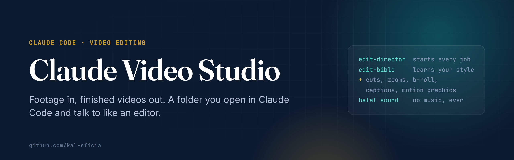

<p align="center"></p>

<p align="center">
  
  
  
  
</p>

A video editing studio you talk to. Open this folder in Claude Code, drop footage in, and say what you want:

> Edit this into a YouTube video.
> Make a captioned voiceover reel from this script and recording.
> Build my edit bible from these four videos.

Claude cuts silences and false starts, adds punch-in zooms, sources b-roll, burns in captions, builds motion graphics, renders and checks the result. It measures pacing and loudness instead of guessing, and it never adds music.

## How it's organised

```
.claude/skills/
  edit-director/   the lead editor: starts every job, routes to the right skills, holds the standards
  edit-bible/      studies 3 to 5 reference videos and writes your channel's style rules
CLAUDE.md          house rules (halal sound only, natural-sounding scripts, measure before claiming)
setup.sh           one-time install: ffmpeg, yt-dlp, Python env, on-device transcription, HyperFrames
footage/<project>/ raw footage in, working files in footage/<project>/edit/
exports/           finished videos
refs/              reference videos for study only
```

The two skills in this repo are mine. The heavy lifting comes from excellent open-source skills, installed by `install-skills.sh`:

| Skill | From | What it does |
|---|---|---|
| HyperFrames skills | [heygen-com/hyperframes](https://github.com/heygen-com/hyperframes) (Apache 2.0) | Motion graphics, captions, transitions, rendering HTML to video |
| video-use | [browser-use/video-use](https://github.com/browser-use/video-use) (MIT) | Transcribe, cut, grade, subtitles, render |
| cut-video, add-zooms, b-roll-finder, clipify | [Louise de Sadeleer](https://github.com/louisedesadeleer) (MIT) | Tightening, punch-in zooms, b-roll, vertical clips |

## Set up

```bash
git clone https://github.com/kal-eficia/claude-video-studio
cd claude-video-studio
./install-skills.sh   # editing skills
./setup.sh            # media tools, Python env, transcription (Claude runs this itself on first use)
claude
```

Transcription runs free on-device with `mlx-whisper`. Add an ElevenLabs key if you want speaker labels.

## The house rules

- **Halal sound only.** No music of any kind: no beds, no melodic stingers, no beat-driven risers. Non-musical sound effects only, and any tool step that adds music is skipped.
- **Scripts read aloud sound like speech,** not choppy written copy.
- **Only footage you own** or have the right to publish. Reference videos are for study.
- **Measure, don't claim.** Claude can't hear the mix, so it reports loudness, pacing and frame checks as numbers.

Fork it and change `CLAUDE.md` to make the studio yours.

---

Built by [Kalid Nur](https://github.com/kal-eficia). MIT licence for the code and skills in this repo; third-party skills keep their own licences.
